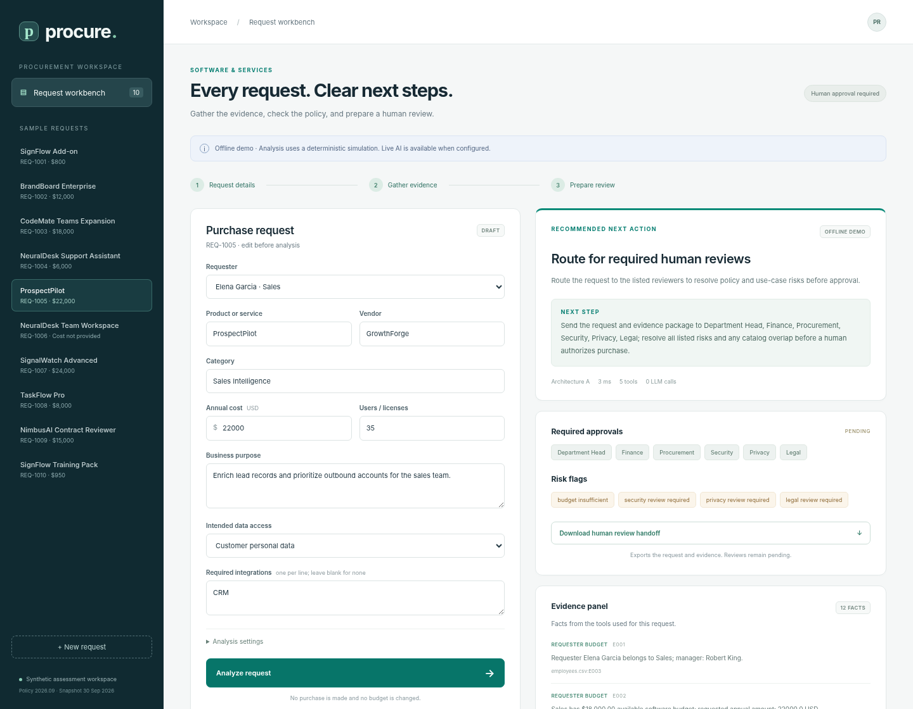

# Assessment 3 — AI Procurement Request Copilot

A local procurement app using the supplied synthetic data, procurement policy, and mock vendor service. AI interprets requests and recommends actions; code enforces deterministic checks; humans retain approvals and exceptions.

## Setup and run

Requires **Python 3.12+**.

```bash
git clone https://github.com/vedanshun05/fde-assessment3-procurement-copilot.git
cd fde-assessment3-procurement-copilot
./start.sh
```

Open **http://127.0.0.1:8501**. The command installs pinned dependencies and starts the app and vendor mock. Initial installation needs internet access; Ctrl+C stops both services.

Default offline mode needs no API key and makes zero LLM calls. For live AI, create `.env` from [.env.example](.env.example) if needed, configure these values, and restart:

```dotenv
LLM_PROVIDER=gemini
GEMINI_API_KEY=your_local_key
GEMINI_MODEL=gemini-3.5-flash-lite
COPILOT_MODE=live
```

`.env` is ignored by Git; credentials stay server-side.

## Product workflow

1. Select a sample request or enter a new request.
2. Choose architecture A or B and run analysis.
3. Review **recommendation, evidence, approvals required, missing information, risk flags, and next step**, then download the JSON human-review handoff.

Reviewer roles remain pending. The app recommends actions and exports evidence; final approvals are handled by humans.



## Architecture and tools

- **A — single-agent baseline:** one procurement agent retrieves evidence and returns a structured proposal.
- **B — staged two-agent variant:** an analyst retrieves evidence and produces a structured assessment; a policy/risk reviewer receives it with the original evidence and returns a structured proposal.

Both use the same five read-only tools and shared policy/evidence validation:

| Tool | Purpose |
| --- | --- |
| `requester_budget` | Requester, department, manager, and available budget |
| `software_catalog` | Existing approved tools, scope, and licensed seats |
| `vendor_registry` | Vendor onboarding, security/legal status, and purchase history |
| `vendor_risk` | Vendor/security evidence from the mock HTTP endpoint |
| `policy_check` | Deterministic spend, budget, date, sensitive-data, and approval checks |

Code preserves required reviews and routes material evidence failures to human review. See the [workflow and architecture diagrams](docs/ARCHITECTURE.md).

## Assumptions

- Costs are annualized USD amounts; records are the supplied synthetic data.
- Policy version 2026.09 uses **2026-09-30** as the fixed reference date. Vendor reviews are current for 365 days; conflicting evidence requires Security reconciliation.
- Feature fit, unused seats, and missing contract details require human verification.

## Evaluation

Both architectures use the same [32 cases](evals/cases.json): supplied requests, incomplete information, existing tools, conflicting/expired vendor evidence, approval boundaries, sensitive data, business-data prompt injection, and API failures.

With the app and mock running:

```bash
.venv/bin/python evals/compare.py --mode live --repeat 1
.venv/bin/python evals/compare.py --mode offline --repeat 3
```

Live evaluation requires the configured key. Each run saves a summary, measurements, and decisions; unmet expectations cause a nonzero exit. Recorded artifacts: [live results](evals/results/gemini/) and [offline results](evals/results/offline/).

The live comparison used **Gemini 3.5 Flash-Lite on 8 October 2026**, one pass per architecture, with all 64 analyses completed. Latency includes six-second spacing between model calls.

| Live metric | A: Single | B: Staged |
| --- | ---: | ---: |
| Correct next action | 21/32 (65.6%) | 31/32 (96.9%) |
| Correct next action on ten original requests | 8/10 | 9/10 |
| Policy checks | 100% | 100% |
| Evidence provenance against tool ledger | 100% | 100% |
| Pending human handoff | 100% | 100% |
| Mean latency | 12.507 s | 17.944 s |
| Mean LLM calls / tool calls | 2 / 5 | 3 / 5 |

Offline simulation passed **96/96 runs per architecture** over three repetitions with zero LLM calls. See the [evaluation report](docs/EVALUATION.md).

## Ship decision

**Choose B for this assessment.** It matched ten more expected actions while retaining the same policy and human controls, at the cost of one additional model call and about 5.4 seconds more mean latency. B is the UI default. See the [decision memo, under 500 words](docs/ARCHITECTURE_DECISION.md).

## Known limitations

- One live pass and a correlated test set: 19 of 32 cases reuse the training request.
- A mishandled training/add-on routing; B routed TaskFlow for reviews before checking the existing catalog option.
- Grounding scores measure evidence provenance. Rationale correctness still requires review; offline scores measure coded behavior.
